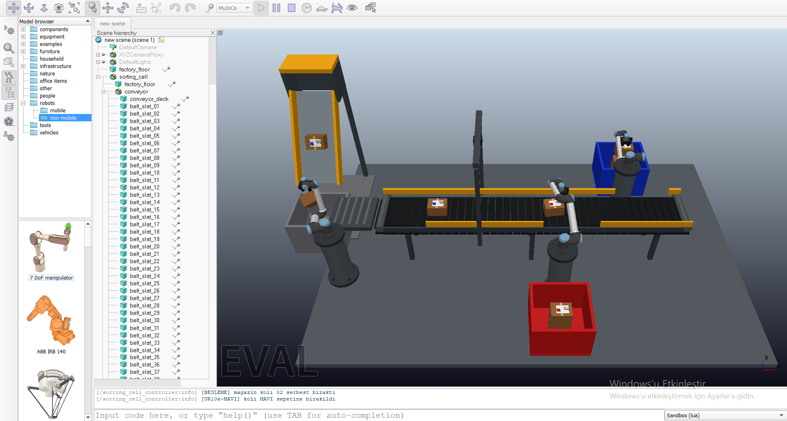
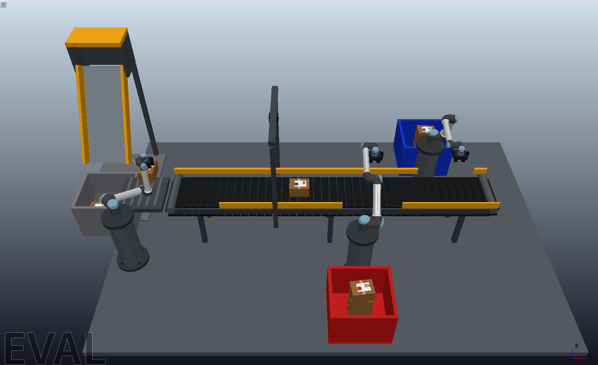

# UR10e Cargo Sorting Automation

A physics-based virtual commissioning project for an automated cargo sorting cell built with three Universal Robots UR10e manipulators, a closed-loop conveyor, vision stations, and vacuum handling.



## Overview

The simulation models the complete parcel flow: packages are released from an infeed magazine, picked and oriented by the first UR10e, inspected on the conveyor, and sorted into red or blue bins by two downstream robots. The scene runs in CoppeliaSim 4.10 with MuJoCo contact physics and a 5 ms simulation step.



## Highlights

- Three UR10e robots using official visual, collision, mass, inertia, and joint-limit data
- Procedural four-cup vacuum end effectors inspired by the Robotiq EPick
- Closed-loop conveyor slats whose motion transports parcels through physical contact
- Basler ace 2 main inspection camera and three RealSense D455 local camera models
- Physical parcels with randomized mass, pose, label orientation, and color destination
- Infeed pick, orientation check, label-up correction, conveyor transfer, tracking, and bin placement
- Exclusive red/blue task reservation to prevent duplicate robot ownership
- IK motion with TCP arrival checks, motion watchdogs, and collision recovery
- Continuous parcel recycling for stable long-duration memory use
- One-command scene generation and launch on Windows

## Process Flow

1. The magazine releases a parcel into the infeed area.
2. The infeed UR10e picks it with vacuum and places it at the inspection station.
3. A local camera verifies the label orientation; the robot corrects the parcel if required.
4. The parcel is transferred to the moving conveyor.
5. The main camera assigns a destination and reserves the parcel for the matching robot.
6. The red or blue sorting UR10e tracks, picks, and places the parcel in its destination bin.
7. Parcels are recycled back into the pool after a configurable dwell time.

## Technology

- CoppeliaSim 4.10 Pro
- MuJoCo physics engine
- Python 3.11+
- Lua scene controller
- ROS 2 Jazzy interface definitions
- PyYAML and pytest
- Universal Robots ROS 2 Description 4.3.1

## Quick Start

### Prerequisites

- Windows 10 or 11
- Git
- Python 3.11–3.14
- CoppeliaSim 4.10 with the ZeroMQ remote API enabled

### Setup

```powershell
git clone https://github.com/orhanucok/ur10e-cargo-sorting-automation.git
cd ur10e-cargo-sorting-automation

py -3.11 -m venv work\.venv
.\work\.venv\Scripts\python.exe -m pip install -e ".[dev,sim]"
.\scripts\bootstrap_vendor.ps1
```

### Run

```powershell
.\scripts\launch_project.ps1
```

The launcher runs the core safety tests, verifies the pinned UR10e model, locates CoppeliaSim, builds a fresh scene, and starts the simulation.

To create a desktop shortcut:

```powershell
.\scripts\create_desktop_shortcut.ps1
```

## Tests

```powershell
.\work\.venv\Scripts\python.exe -m pytest -q
```

The test suite covers configuration safety rules, parcel ownership, red/blue robot assignment, low-confidence rejection, task state transitions, arrival-time ordering, parcel inertia, and vacuum grip limits.

## Configuration

- `config/cell.yaml` — cell geometry, conveyor behavior, cameras, robots, parcel supply, and timing
- `config/physics.yaml` — contact, friction, vacuum, mass, and dynamics parameters
- `vendor.lock.json` — pinned upstream robot-description and simulator versions

## Repository Structure

```text
config/       Cell and physics configuration
coppeliasim/  Scene builder and Lua runtime controller
docs/images/  Project screenshots used by this README
ros2_ws/      ROS 2 messages, actions, and coordination core
scripts/      Setup, launch, watchdog, and shortcut utilities
tools/        URDF preparation and diagnostics
outputs/      Validation captures and engineering notes
```

## Reliability and Recovery

An independent watchdog monitors controller heartbeat, production progress, and simulator state every two seconds. It resumes an unexpected pause and rebuilds the scene if the heartbeat stalls for 20 seconds or production does not advance for 60 simulation seconds. Collision recovery stops the conveyor and retracts the affected robot vertically before resuming operation.

The infeed system reuses a bounded parcel pool instead of generating unlimited scene objects. Supply interval, pool size, and output-bin dwell time can be adjusted in the `infeed_supply` section of `config/cell.yaml`.

## Simulation Scope

The current scene uses MuJoCo contact physics, official UR10e geometry and dynamics, and a working end-to-end task flow. Vacuum attachment is represented by a rigid hold constraint after contact-distance validation. Color classification and label-orientation checks currently use simulation ground truth derived from parcel state.

Pixel-based OpenCV/OCR perception, ROS 2 Jazzy runtime integration, and MoveIt 2 planning are intended as the next commissioning layer. For hardware-correlated results, cardboard friction, vacuum sealing, camera latency, and robot velocity/acceleration limits should be calibrated from measurements and recorded in `config/physics.yaml`.

## License

No project-wide license has been assigned yet. The pinned Universal Robots description package retains its upstream license and mesh-specific terms.
